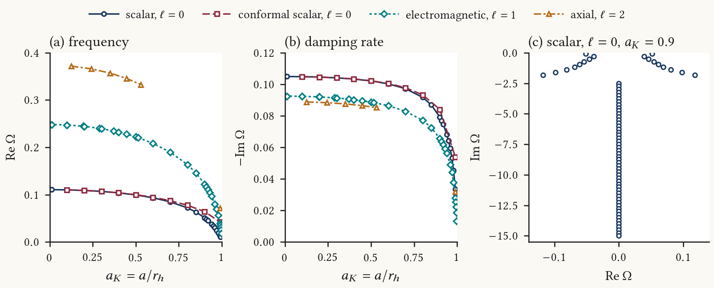

<!-- Author: Dr. Denys Dutykh (Mathematics Department, Khalifa University of Science and Technology, Abu Dhabi, UAE) -->

# KS-quantum: quasinormal modes of the Kazakov–Solodukhin quantum-corrected black hole



The fundamental quasinormal mode Ω = Mω of four perturbation sectors against the horizon-normalised deformation
a_K = a/r_h, read from the tables of `reports/`, and the whole retained spectrum of one of them. Panels (a) and (b)
show the real part and the damping rate: as a_K grows towards 1, every sector oscillates more slowly and is damped
more weakly, and the minimally and conformally coupled scalar monopoles part visibly only beyond a_K ≈ 0.7. Panel (c)
shows every root of the minimally coupled scalar monopole at a_K = 0.9 that passes the three-resolution test described
below (roots of modulus below 10⁻³ left out): nine pairs of oscillatory overtones and, below them, a ladder of purely
imaginary roots spaced by 1/4, from −2.50i down to −15.00i.

KS-quantum holds the Maple worksheets, the Julia solver and the computed spectra of the article by Davide Batic, Denys
Dutykh and Mark Essa Sukaiti in The European Physical Journal C (2026), cited below. The Kazakov–Solodukhin black hole
is a spherically symmetric deformation of the Schwarzschild solution by quantum corrections. Its quasinormal modes are
computed for four perturbation sectors (the minimally coupled scalar field, the electromagnetic field, the conformally
coupled scalar field, and an axial effective-source Regge–Wheeler model of gravitational perturbations) by a Chebyshev
spectral method in high-precision arithmetic: Maple assembles a quadratic matrix pencil with 200 decimal digits, and
Julia solves it with 220 digits at three resolutions and keeps the roots on which the three agree. The tables of 141
cases (sector, multipole ℓ and deformation) are stored in `reports/`.

## The problem

In units with c = G = ℏ = 1 and with the time dependence e^(−iωt), the line element and the radial equation of the
scalar (s = 0) and electromagnetic (s = 1) perturbations are

```text
ds² = −f(r) dt² + dr²/f(r) + r² (dϑ² + sin²ϑ dφ²),      f(r) = ( √(r² − a²) − 2M ) / r,      r > a,

f d/dr( f dψ/dr ) + ( ω² − U(r) ) ψ = 0,      U(r) = f(r) ( ε f′(r)/r + ℓ(ℓ+1)/r² ),      ε = 1 − s²,
```

where M is the mass and a² = 4G_R/π the deformation parameter. The event horizon lies at r_h = √(4M² + a²), and the
curvature singularity at r = a. The conformally coupled scalar field and the axial sector keep the same equation with
other potentials:

```text
V_c(r)  = f(r) ( ℓ(ℓ+1)/r² + f′(r)/r + R(r)/6 ),      R(r) = 2/r² + (3a² − 2r²) / ( r (r² − a²)^(3/2) ),

V_ax(r) = f(r) ( ℓ(ℓ+1) − 2 + 2 f(r) − r f′(r) ) / r².
```

Since the spacetime is not Ricci flat, the axial potential belongs to an effective-source model in which the matter
that supports the geometry carries no axial perturbation of its own; its spectrum is that of this model, not the full
gravitational spectrum of a given quantum-gravity action (section 2 of the article). The quasinormal modes are the
frequencies with Im Ω < 0 for which the wave is ingoing at the horizon and outgoing at infinity.

| Sector | Spin s | Multipoles in `reports/` |
|---|---|---|
| minimally coupled scalar | 0 | ℓ = 0 to 5 |
| electromagnetic | 1 | ℓ = 1 to 5 |
| conformally coupled scalar | 0 | ℓ = 0 |
| axial effective-source Regge–Wheeler | 2 | ℓ = 2 to 5 |

Two normalisations of the deformation are used, by the article and by the file names:

```text
𝔞 = a/M   (mass-normalised, 0 ⩽ 𝔞 < ∞),      a_K = a/r_h = 𝔞 / √(𝔞² + 4)   (horizon-normalised, 0 ⩽ a_K < 1).
```

For instance a_K = 0.3, 0.5, 0.9 and 0.99 correspond to 𝔞 = 0.629, 1.155, 4.129 and 14.04, and the near-extremal limit
is a_K → 1, that is 𝔞 → ∞.

The method factors out the behaviour of the modes at the horizon and at infinity, maps the exterior of the black hole
onto the interval −1 ⩽ y ⩽ 1, expands the remaining regular function in Chebyshev polynomials and collocates the
equation at the Chebyshev–Gauss points. The result is a quadratic pencil in Ω = Mω,

```text
( M0 + i Ω M1 + Ω² M2 ) c = 0,
```

with real N × N matrices `M0`, `M1`, `M2`, which the solver writes as a generalised eigenvalue problem of size 2N. It
is solved at N = 190, 195 and 200, and a root is kept only when the three resolutions agree: with Ω₁₉₀ a root at
N = 190, Ω₁₉₅ the nearest root at N = 195 and Ω₂₀₀ the root at N = 200 nearest to Ω₁₉₅, the triplet is accepted when

```text
max( |Ω₁₉₀ − Ω₁₉₅|, |Ω₁₉₅ − Ω₂₀₀|, |Ω₁₉₀ − Ω₂₀₀| )  ⩽  max( 10⁻⁴, 10⁻⁴ · max(1, |Ω₁₉₀|, |Ω₁₉₅|, |Ω₂₀₀|) ),
```

and the tables give the average (Ω₁₉₀ + Ω₁₉₅ + Ω₂₀₀)/3. This is the criterion (103) of the article, with the tolerances
`STABLE_ABSTOL` and `STABLE_RELTOL` of the solver equal to 10⁻⁴; every one of the 9428 roots stored in `reports/`
satisfies it, the largest normalised distance being 9.98 × 10⁻⁵. Only roots with Im Ω < −10⁻¹⁸ enter the tables. The
solver also gathers, at each resolution, the roots with Im Ω > 10⁻¹⁸ and applies the same test to them; the article
reports that no growing mode survives it, within the deformations and resolutions computed.

The spectral results agree with the WKB, time-domain, Mashhoon and asymptotic-iteration values of the literature where
they overlap, once the normalisations are matched. The method also resolves higher overtones and purely imaginary
roots spaced by about Mκ = 1/4, the surface gravity of the Schwarzschild black hole in units of 1/M; near extremality
these roots approach the ladder Ω_n ≈ −i(n + 1)/4 in the scalar, electromagnetic and axial sectors (at a_K = 0.99 the
scalar monopole gives −0.2520i, −0.5008i, −0.7505i, −1.0003i), while the oscillatory modes remain different from one
sector to another.

## Quick start

The computation has two stages. First, Maple assembles the three matrices for one sector, multipole and deformation,
at each of the three resolutions: open the worksheet of the sector in `maple/` (see Contents), set the spin s, the
multipole L, the deformation a and the resolutions (the worksheet as saved last assembled N = 90, 95 and 100; the solver
expects the values of its constant `N_VALS`, that is 190, 195 and 200), and run it. It writes the ASCII files

```text
M0-<N>-s<S>_L<L>_a<TAG>.mat      M1-<N>-s<S>_L<L>_a<TAG>.mat      M2-<N>-s<S>_L<L>_a<TAG>.mat
```

where the tag is the deformation as the worksheet writes it into the file name; the reports were made with the integer
tag 1000 𝔞 (for example 629 for 𝔞 = 0.629, that is a_K = 0.3, and 0 for the Schwarzschild black hole).

Second, Julia solves the pencil. Set the three constants near the top of
`julia/KS_spectral_solver_with_unstable_check.jl` to the same case,

```julia
const SPIN = 1                  # 0 scalar, 1 electromagnetic, 2 axial
const ELL  = 1                  # multipole: ℓ ⩾ 0, ℓ ⩾ 1 and ℓ ⩾ 2 respectively
const DEFORMATION_TAG = "629"   # the tag of the .mat file names
```

and give the folder of the matrices and an output folder through two environment variables (the default of the first
is the folder of the authors' computer):

```bash
export KS_DATA_DIR=/path/to/the/matrices
export KS_OUT_DIR=/path/to/the/output
julia julia/KS_spectral_solver_with_unstable_check.jl
```

For each case the solver writes into `KS_OUT_DIR` the finite and the damped spectra at each resolution
(`spectrum_finite-N*` and `spectrum_candidates-N*`, `.dat`), the retained modes (`stable_modes-<tag>.txt`, with a
`_details` and a `_full_precision` companion, and the oscillatory and purely imaginary ones apart in
`stable_modes_oscillatory-<tag>.dat` and `stable_modes_pure_imag-<tag>.dat`), the test of growing modes
(`unstable_candidates-N*` and `unstable_modes-<tag>.txt`, which reads "No unstable mode detected." when none survives),
and pictures of the spectrum in the complex plane (`qnm_plot*`, PNG and HTML).

## Contents

| Folder | What it holds |
|---|---|
| `maple/` | `Matrix_Assembler_all_s_0_s_1_KS-Final Version.mw`, the assembler of the scalar and electromagnetic pencils, and the worksheets of the three sectors with their derivations: `01-CASE-s0_s1-SUPPLEMENTAL MATERIAL.mw` (scalar and electromagnetic), `01-CASE-s0conf-SUPPLEMENTAL MATERIAL.mw` (conformally coupled scalar) and `01-CASE-s2-SUPPLEMENTAL MATERIAL.mw` (axial sector) |
| `julia/` | `KS_spectral_solver_with_unstable_check.jl`, the solver, the three-resolution test and the test of growing modes |
| `reports/s0/` | 48 tables of the minimally coupled scalar field |
| `reports/s0-conformal/` | 10 tables of the conformally coupled scalar field |
| `reports/s1/` | 59 tables of the electromagnetic field |
| `reports/s2-axial/` | 24 tables of the axial sector |
| `200digit200l0s0/` | the raw spectra of the scalar monopole at N = 190, 195 and 200 with 200 digits (`eigs-<N>-<tag>_full.txt`, Re Ω and Im Ω in two columns), the roots matched across them (`stable_modes.txt`) and pictures of the spectra |
| `200Digit400l0s0/` | pictures of the same spectra computed with 200 digits and 400 polynomials, as the name of the folder records |
| `400digit400L0S0/` | two pictures of the real and imaginary parts of the first seven modes of the scalar monopole against α = a/(2M) from 0 to 1, computed with 400 digits and 400 polynomials, as the name of the folder records |
| `pdf/` | the published article (`DB-DD-MS-QNMs-KS-Quantum-EPJC-2026.pdf`, open access) and the preprint |
| `docs/figures/` | the script that draws the figure of this page from `reports/`, and the style file beside it |

Each table of `reports/` belongs to one sector, one multipole and one deformation, named
`s<spin>_L<ℓ>_a<value>.txt`, with the decimal point written as an underscore: `aK0_9` stands for a_K = 0.9, `a1_25`
for 𝔞 = 1.25 and `a0` for the Schwarzschild black hole. Its header repeats the case, with the integer tag 1000 𝔞, and
its columns give the running index `k`, the average `Re(avg)` and `Im(avg)` of the matched roots with 16 decimals, the
three distances `err12`, `err23`, `err13` between the roots at N = 190, 195 and 200, and the largest of them `maxerr`.
Oscillatory modes come in pairs ±Re Ω, and purely imaginary roots have `Re(avg)` equal to 0. The solver also writes
each table at full precision (`_full_precision`), but these files are not stored here. The tables also keep a few
purely imaginary roots of modulus below 10⁻³, which pass the test through its absolute part of 10⁻⁴ only and are not
listed by the article.

The three folders whose names begin with `200` or `400` hold a study of the scalar monopole (s = 0, ℓ = 0) under a
change of precision and resolution. Their subfolders `data-0`, `data-5` and `data-10` are named after 10 α, with
α = a/(2M) = 𝔞/2: they hold 𝔞 = 0, 1 and 2, that is a_K = 0, 0.447 and 0.707. Their fundamental modes,
0.1104549391 − 0.1048957171i, 0.1018412841 − 0.1027915191i and 0.0840015525 − 0.0969339948i at the three resolutions
alike, are those of the tables of `reports/s0/` at these deformations.

## Requirements

Maple, for the worksheets (saved with Maple 2024). Julia, for the solver, with the packages GenericSchur, Plots and
PlotlyJS (DelimitedFiles, Printf and LinearAlgebra come with Julia):

```julia
import Pkg
Pkg.add(["GenericSchur", "Plots", "PlotlyJS"])
```

The figure of this page is drawn from `docs/figures/` by `python3 plot_readme_figure.py` (Python 3 with NumPy and
Matplotlib).

## How to cite

If you use these codes or data, please cite the article:

D. Batic, D. Dutykh and M. E. Sukaiti, Quasinormal modes of the Kazakov–Solodukhin quantum-corrected black hole: a
spectral analysis, The European Physical Journal C 86, 847 (2026).

https://doi.org/10.1140/epjc/s10052-026-16102-3

```bibtex
@article{Batic2026d,
  author = {Batic, Davide and Dutykh, Denys and Sukaiti, Mark Essa},
  title = {Quasinormal Modes of the {{Kazakov}}--{{Solodukhin}} Quantum-Corrected Black Hole: A Spectral Analysis},
  journal = {The European Physical Journal C},
  year = 2026,
  month = jul,
  volume = {86},
  number = {7},
  pages = {847},
  doi = {10.1140/epjc/s10052-026-16102-3},
  eprint = {2607.19860},
  archiveprefix = {arXiv}
}
```

The button "Cite this repository" in the right-hand column of this page gives the same reference, read from
`CITATION.cff`. The article is open access, and its preprint is on arXiv:

https://arxiv.org/abs/2607.19860

The quasinormal-mode codes of this family are gathered in the QNMs Hall of Fame:

https://qnms.denys-dutykh.com/

## Licence

GNU Lesser General Public License, version 2.1 (see `LICENSE`).

## Authors

Davide Batic, Denys Dutykh and Mark Essa Sukaiti (Mathematics Department, Khalifa University of Science and
Technology, Abu Dhabi).

https://www.denys-dutykh.com/
